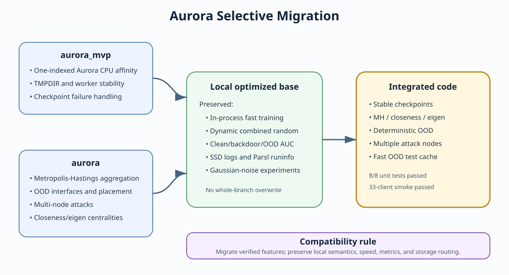

# Aurora selective migration — 2026-11-24

## Outcome

The project keeps the locally optimized `main` implementation as its base and
selectively integrates compatible features from the upstream `aurora_mvp` and
`aurora` branches. A whole-branch merge was intentionally avoided because the
upstream branches do not contain the local AUC metrics, dynamic combined-random
strategies, SSD output routing, or in-process fast path.



## Upstream references

- `aurora_mvp`: commit `a1899e3` (2026-02-09), focused on Aurora worker,
  checkpoint, and I/O stability.
- `aurora`: commit `a5cfff2` (2026-04-07), containing later OOD, multi-node,
  and aggregation work.
- Local optimized base: commit `b080ff1`.
- Integration branch: `integration/aurora-selective`.

## Migrated features

### Aggregation

- `mhCent`: Metropolis-Hastings weights with self-loops. The resulting matrix
  is symmetric, sparse, row-stochastic, and column-stochastic.
- `closeCent` and `closenessCent`: both names are accepted for compatibility.
- `eigenCent`: eigenvector-centrality aggregation.
- All three paths work with both the Parsl implementation and the optimized
  in-process snapshot aggregation path.
- Existing `random_betCent` and `random_degCent` continue to refresh their
  random component every round.

### OOD and multi-node placement

The new unified command-line interface is:

```text
--ood_type TYPE
--ood_node_idxs NODE [NODE ...]
--ood_proportion FLOAT
--ood_severity {1,2,3,4,5}
```

Supported image OOD types in this migration stage are:

- `noise` / `impulse_noise`
- `gaussian_noise`
- `blur`
- `defocus`
- `weather`
- `brightness`
- `contrast`
- `pixelate`
- `bd` / `backdoor`

Image corruption is deterministic per sample and seed, preserves labels, and
is applied on the original `[0, 1]` pixel scale. FMNIST/MNIST remain in
`[0, 1]`; normalized CIFAR inputs are converted from and back to `[-1, 1]`.
The implementation uses PyTorch only, avoiding mandatory OpenCV and
scikit-image dependencies. The global OOD evaluation dataset has a
thread-safe cache so 33 clients do not regenerate identical corruptions.

The existing interfaces remain supported:

- `--backdoor --backdoor_node_idxs ...`
- `--noise_node_idxs ... --noise_std ... --noise_mix_ratio ...`

Multiple backdoor or OOD nodes are validated against the topology before the
run starts. Backdoor test-set proportion now follows the configured
`backdoor_proportion` instead of a hard-coded `0.1`.

### Metrics

Final OOD evaluation records:

- `ood_acc`
- `ood_auc_macro`
- `ood_auc_weighted`

Existing clean and backdoor metrics are unchanged.

### Reliability

- Aurora worker CPU affinity uses the upstream validated one-indexed mapping.
- Aurora workers export `TMPDIR=/tmp`.
- Checkpoints are written to a temporary file in the destination directory,
  checked for non-zero size, and atomically published with `os.replace`.
- Checkpoint writing retries up to three times and removes temporary files.
- Corrupt checkpoints are renamed to `.corrupt-*`, preserving them for
  diagnosis; the loader then tries the next older checkpoint. It never deletes
  the complete experiment directory.
- All experiment, Parsl, and smoke-test output remains under `/ssd`.

## Verification

### Unit tests

Command:

```bash
/ssd/haibin/miniconda3/envs/topo/bin/python -m unittest -v tests.test_noise_and_mh
```

Result: **8/8 passed**. Coverage includes Gaussian ranges, selected-sample
noise, eight OOD transformations, Parsl serialization, MH matrix properties,
closeness/eigen centralities, and atomic checkpoints.

### End-to-end smoke test

Configuration:

- Dataset: FMNIST
- Topology: BA, `n=33`, `m=3`
- Aggregation: `mhCent`
- OOD: `blur`, severity 2, proportion 0.1
- OOD nodes: `23, 27, 28, 30`
- Rounds/epochs: 1/1
- GPU: 0
- Test-only evaluation limit: 256 samples

Result:

- Exit status: success
- End-to-end time: 41.37 seconds
- Final client rows: 33/33
- OOD Acc/macro AUC/weighted AUC: 33/33 non-null for each metric
- Checkpoint: round 0, 33 client state dictionaries, 33 results
- Temporary checkpoint files remaining: 0
- Resume check: the same run loaded `0_ckpt.pth`, detected completion, and
  exited successfully without retraining

Artifacts:

```text
/ssd/haibin/logs/aurora_selective_migration_smoke/
  mh_ood_multinode_smoke/
    mh_ood_multinode_smoke_72164d273a07/
```

The environment variable `TOPO_FL_EVAL_LIMIT` is a smoke-test-only override.
It is unset for formal experiments, which therefore evaluate the full test
set.

## Deferred upstream items

The following are deliberately not copied in this stage because they need
extra datasets/assets or a separate mathematical compatibility review:

- Frost images and exact OpenCV/scikit-image corruption implementations.
- Camelyon17 hospital OOD and TinyMem task-7 OOD.
- Generic Sinkhorn/Frobenius projection of every centrality matrix.
- Aurora dummy I/O-scaling benchmark scripts.

These items do not block the planned FMNIST/CIFAR10 BA experiments using
backdoor, Gaussian/impulse noise, blur, or `mhCent`.
