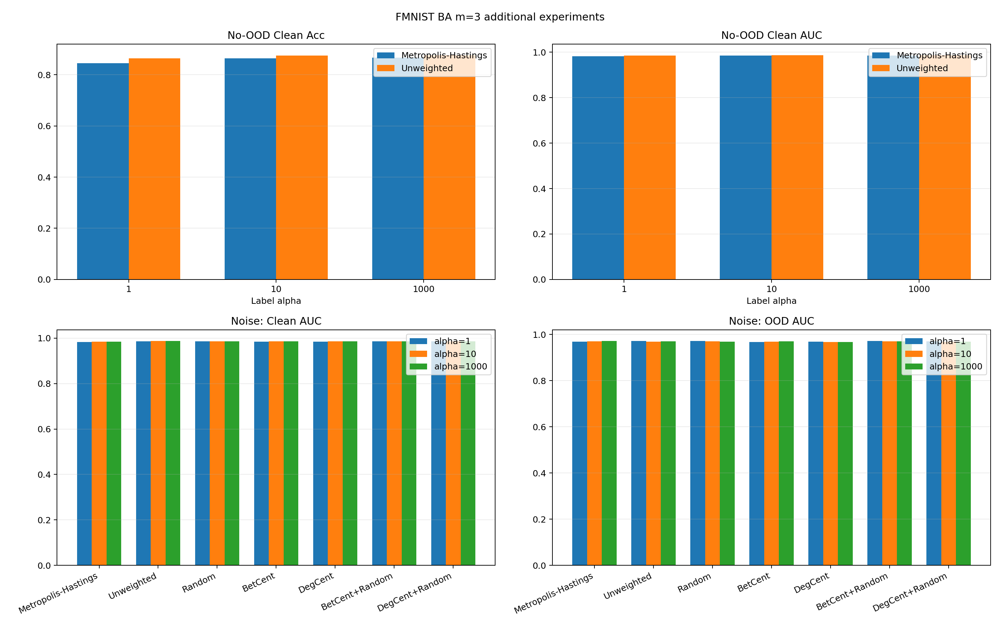

# FMNIST BA m=3 additional experiments

Updated: 2026-11-24

## Configuration

- 33 clients; BA m=3; 40 rounds; 5 local epochs; batch size 16
- Adam, learning rate 1e-4; seed 1; sample alpha 1000
- Label alpha: 1, 10, 1000
- Noise: impulse noise, severity 5, proportion 0.1
- Noise nodes: 23, 27, 28, 30
- Values are means over 33 client records at final round 39
- Raw output root: `/ssd/haibin/logs/topology_aware_learning_fmnist_additional_ba_m3_20261124`

## No-OOD additions

| Label alpha | Aggregation | Clean Acc | Clean AUC macro | Clean AUC weighted |
|---:|---|---:|---:|---:|
| 1 | Metropolis-Hastings | 0.845670 | 0.982831 | 0.982831 |
| 1 | Unweighted | 0.863900 | 0.985607 | 0.985607 |
| 10 | Metropolis-Hastings | 0.863588 | 0.984849 | 0.984849 |
| 10 | Unweighted | 0.875061 | 0.987046 | 0.987046 |
| 1000 | Metropolis-Hastings | 0.866276 | 0.985130 | 0.985130 |
| 1000 | Unweighted | 0.876385 | 0.987135 | 0.987135 |

## Four-node noise experiments

| Label alpha | Aggregation | Clean Acc | Clean AUC macro | Clean AUC weighted | OOD Acc | OOD AUC macro | OOD AUC weighted |
|---:|---|---:|---:|---:|---:|---:|---:|
| 1 | Metropolis-Hastings | 0.845491 | 0.982748 | 0.982748 | 0.778594 | 0.968773 | 0.968773 |
| 1 | Unweighted | 0.865061 | 0.985778 | 0.985778 | 0.793851 | 0.971137 | 0.971137 |
| 1 | Random | 0.862033 | 0.985326 | 0.985326 | 0.795109 | 0.971005 | 0.971005 |
| 1 | BetCent | 0.858767 | 0.984001 | 0.984001 | 0.783121 | 0.967333 | 0.967333 |
| 1 | DegCent | 0.858703 | 0.984399 | 0.984399 | 0.783700 | 0.968177 | 0.968177 |
| 1 | BetCent+Random | 0.863294 | 0.985464 | 0.985464 | 0.796261 | 0.971010 | 0.971010 |
| 1 | DegCent+Random | 0.861215 | 0.985354 | 0.985354 | 0.787421 | 0.970068 | 0.970068 |
| 10 | Metropolis-Hastings | 0.862439 | 0.984795 | 0.984795 | 0.786461 | 0.969664 | 0.969664 |
| 10 | Unweighted | 0.874324 | 0.986953 | 0.986953 | 0.786439 | 0.969108 | 0.969108 |
| 10 | Random | 0.874327 | 0.986686 | 0.986686 | 0.794279 | 0.969920 | 0.969920 |
| 10 | BetCent | 0.870391 | 0.986201 | 0.986201 | 0.791594 | 0.968412 | 0.968412 |
| 10 | DegCent | 0.870894 | 0.985959 | 0.985959 | 0.781355 | 0.966852 | 0.966852 |
| 10 | BetCent+Random | 0.873945 | 0.986706 | 0.986706 | 0.791461 | 0.969354 | 0.969354 |
| 10 | DegCent+Random | 0.872055 | 0.986384 | 0.986384 | 0.786745 | 0.968575 | 0.968575 |
| 1000 | Metropolis-Hastings | 0.866170 | 0.985083 | 0.985083 | 0.794188 | 0.971002 | 0.971002 |
| 1000 | Unweighted | 0.875851 | 0.987190 | 0.987190 | 0.787912 | 0.970704 | 0.970704 |
| 1000 | Random | 0.874794 | 0.986693 | 0.986693 | 0.784697 | 0.969036 | 0.969036 |
| 1000 | BetCent | 0.871055 | 0.986372 | 0.986372 | 0.790270 | 0.969302 | 0.969302 |
| 1000 | DegCent | 0.868961 | 0.986090 | 0.986090 | 0.778279 | 0.967602 | 0.967602 |
| 1000 | BetCent+Random | 0.874736 | 0.986716 | 0.986716 | 0.787564 | 0.969372 | 0.969372 |
| 1000 | DegCent+Random | 0.875248 | 0.986754 | 0.986754 | 0.780461 | 0.968420 | 0.968420 |

## Highlights

- Best noise-condition Clean AUC: **0.987190** —
  alpha=1000, Unweighted.
- Best OOD AUC: **0.971137** —
  alpha=1, Unweighted.
- Runtime per run: mean 46.13 min, range
  32.45–55.42 min.
- All 27 configurations passed the 33-client, round-39, non-null metric audit.

## Artifacts

- `final_summary.csv`: exact configuration-level metrics and distributions.
- `per_client_results.csv`: all 27 × 33 final client records.
- `results/`: raw CSVs, arguments, logs, and checkpoints.
- `queue.log`: start/completion status and runtimes.
