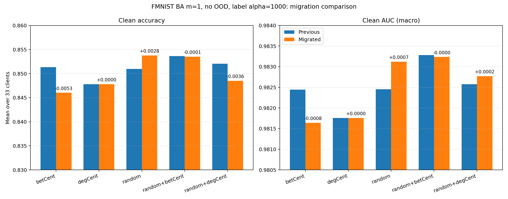

# FMNIST BA m=1 migration comparison

Updated: 2026-11-24

## Configuration

- Dataset: FMNIST, no OOD/backdoor
- Graph: BA, 33 clients, m=1
- Label/sample alpha: 1000/1000
- Training: 40 rounds, 5 local epochs, batch size 16
- Optimizer: Adam, learning rate 1e-4, weight decay 0
- Participation: 1.0; seed: 1
- Scores: mean across 33 final client evaluations at round 39
- Migrated-code commit used by the launcher: `a5f984e`

## Mean-score comparison

| Aggregation | Old Acc | Migrated Acc | Delta | Old AUC macro | Migrated AUC macro | Delta |
|---|---:|---:|---:|---:|---:|---:|
| betCent | 0.851345 | 0.846033 | -0.005312 | 0.982444 | 0.981642 | -0.000802 |
| degCent | 0.847800 | 0.847800 | +0.000000 | 0.981760 | 0.981760 | +0.000000 |
| random | 0.850964 | 0.853779 | +0.002815 | 0.982455 | 0.983122 | +0.000667 |
| random+betCent | 0.853658 | 0.853527 | -0.000130 | 0.983281 | 0.983237 | -0.000044 |
| random+degCent | 0.852058 | 0.848506 | -0.003552 | 0.982578 | 0.982770 | +0.000192 |

Across the five aggregation methods, mean Clean Acc changed from
**0.851165** to **0.849929** (-0.001236), and mean
Clean AUC changed from **0.982504** to **0.982506**
(+0.000003).

`degCent` reproduced exactly for every reported mean and,
for `degCent`, for every one of the 33 client records. This provides a strong
deterministic check that the selective migration did not change the base
FMNIST training/evaluation path.

The remaining differences are small (largest mean Acc absolute delta:
0.005312; largest mean AUC absolute delta:
0.000802). The previous November
runs for several methods were resumed from early optimization checkpoints,
while this comparison started every method from round 0 with one final code
version. Therefore exact equality is not expected for those checkpoint chains.

## Migrated-run client distribution

| Aggregation | Acc median | Acc min | Acc max | AUC median | AUC min | AUC max |
|---|---:|---:|---:|---:|---:|---:|
| betCent | 0.843700 | 0.834000 | 0.863700 | 0.981255 | 0.979510 | 0.984769 |
| degCent | 0.847900 | 0.833400 | 0.862100 | 0.982019 | 0.978640 | 0.984618 |
| random | 0.854500 | 0.838700 | 0.869200 | 0.983261 | 0.981191 | 0.984579 |
| random+betCent | 0.853200 | 0.843100 | 0.866200 | 0.983406 | 0.980889 | 0.984401 |
| random+degCent | 0.849700 | 0.808500 | 0.865200 | 0.983157 | 0.979753 | 0.984395 |

## Runtime

The five methods ran concurrently on GPUs 0, 3, 4, 5, and 6. GPUs 1 and 2
were deliberately excluded.

| Aggregation | Seconds | Minutes |
|---|---:|---:|
| betCent | 2240 | 37.33 |
| degCent | 2007 | 33.45 |
| random | 2052 | 34.20 |
| random+betCent | 2126 | 35.43 |
| random+degCent | 1982 | 33.03 |

All five processes exited successfully; queue failures: 0.

## Data files

- `comparison_summary.csv`: method-level exact means, deltas, distributions,
  paths, and runtimes.
- `per_client_comparison.csv`: old/new/delta values for all 5 × 33 clients.
- `results/`: migrated raw client CSVs, checkpoints, arguments, and logs.
- `stdout/`: complete console logs.
- `queue.log`: launch, completion, exit status, and elapsed time.
