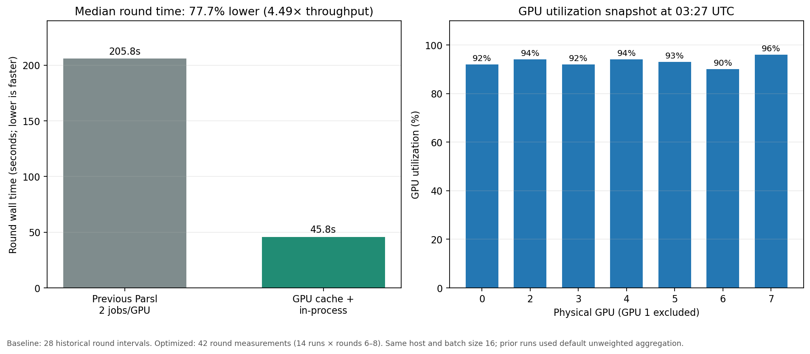

# Runtime speed optimization record — 2026-11-11

## Result

The target of at least 30% faster rounds is exceeded. Across 14 concurrent FMNIST runs, the median round time fell from **205.81 s** to **45.83 s**: **77.7% less wall time per round**, or **4.49× the round throughput**. The 30% target corresponds to 144.07 s/round; the measured median is well below that threshold.

This is a per-round runtime comparison, separate from model-quality results. The completed FMNIST accuracy and AUC scores are reported in [`FMNIST_NO_OOD_FINAL_RESULTS.md`](../FMNIST_NO_OOD_FINAL_RESULTS.md).

## What changed

- Replaced Parsl task submission in this local run with an in-process `ThreadPoolExecutor` (8 client-training threads per experiment).
- Kept each client model on its assigned GPU across rounds. Aggregation uses immutable per-round model snapshots and computes updates on the GPU, avoiding repeated model GPU→CPU→GPU transfers.
- For MNIST/FashionMNIST, converted the source image tensor once using the same `ToTensor` scaling (`uint8 / 255`) and cached each client's samples on the GPU. Training now iterates fixed-size 16-sample tensor slices rather than repeatedly decoding PIL samples and transferring every batch.
- Validated source labels once before caching. The fast path avoids per-batch GPU `.item()` min/max synchronization; cross-entropy still validates labels through its normal class-index bounds.
- Removed concurrent per-client calls that reset PyTorch's process-global random seed. The experiment seed remains applied once at initialization; this FashionMNIST model has no stochastic layer and the loader does not shuffle.
- Checkpoints copy model weights to CPU once at save time.
- Explicitly passed `--aggregation_strategy` for every matrix task. Batch size 16, 40 rounds, 5 local epochs, Adam at `1e-4`, seed 1, and final-only evaluation are unchanged.

## Measurement

| Path | Measurements | Median round | Mean round | Notes |
|---|---:|---:|---:|---|
| Previous Parsl scheduler | 28 round intervals | 205.81 s | 207.14 s | Archived 2-job-per-GPU runs on the same host. Those launch commands defaulted to unweighted aggregation; aggregation itself was about 0.1 s/round, so the main measured cost was local training. |
| GPU cache + in-process | 42 rounds across 14 runs | 45.83 s | 47.12 s | Current logged rounds 6–8, after restoring each run from its latest checkpoint. Range 44.39–54.89 s. |

A separate `nvidia-smi` sample at 03:27 UTC showed 90–96% utilization on GPUs 0, 2–7 (mean 93%); GPU 1 remained unused. GPU utilization supports the runtime result but is not used as its substitute.

## Current experiment state

- All 30 matrix runs completed successfully on GPUs 0, 2–7; queue has 30 starts, 30 completions, and no failures.
- Each run reached round 39/40 and saved its final evaluation metrics. Final scores are summarized in `../FMNIST_NO_OOD_FINAL_RESULTS.md`.
- The first two optimization attempts were stopped: one reported an invalid target and one stalled before client training. Their outputs remain archived and are excluded from the speed comparison.
- Logs, metrics, and checkpoints are under `/ssd/haibin/logs/topology_aware_learning_fmnist_no_noise_20261111/`.

Per-round timing is emitted as `PERF` in each `experiment.log`. The 30-minute monitor remains installed.
